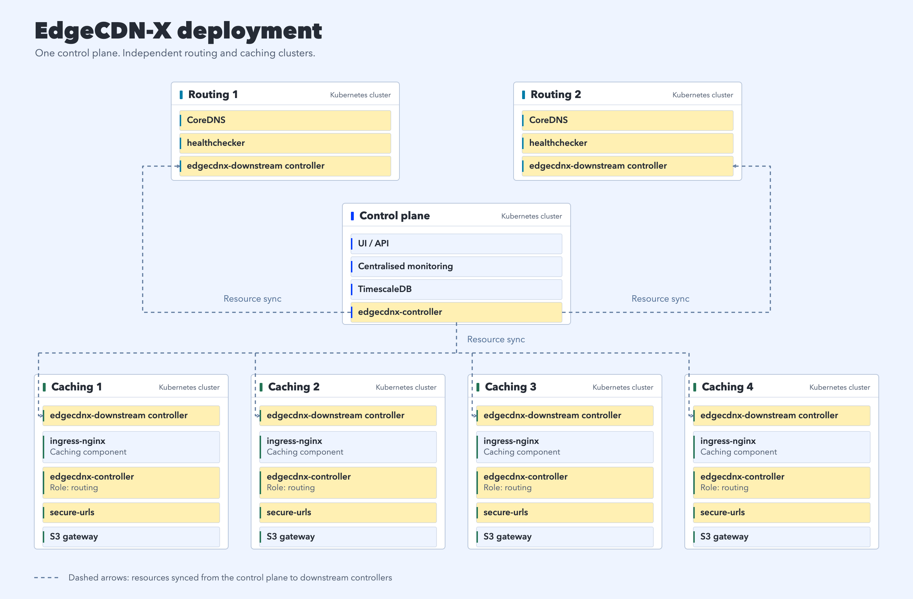
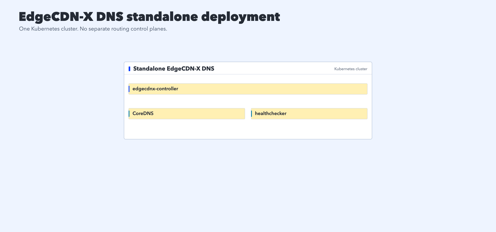

# Getting Started

CDN and DNS is a distributed compute problem and these docs won't specify exact steps how to deploy the platform, since the environment, network, infrastructure varies from vendor to vendor, ISP to ISP, use-case to use-case. We will give tho some best practices how to deploy the base components.

EdgeCDN-X is divided onto two main parts. DNS and Caching, these components can work indidivually, and at the same time the integrator if wishes can replace one or the other with their own component. DNS is build in a way, that it can be compatible with any caching engine, so other engines, such as Varnish, Envoy, or other components can be well integrated with the ecosystem.

## Architecture Overview
The image below represents a full deployment diagram including all the core components and commecial components for production deployment. The highlighted components are Open Source AGPLv3 licensed components.

How to deploy and interconnect the individual clusters is out of the scope of this document, and should be evaluated environment by environment.

* Control plane - Runs the controller with optional UI/API and TimescaleDB. TimescaleDB is only necessary if the UI and API is deployed.
* Routing clusters - Runs CoreDNS with the EdgeCDN-X Plugin alongside the downstream controller (edgecdnx-controller - role downstream) to sync the necessary resources for configuration from the control plane
* Healthchecker - Runs active healthchecks agains the defined HealthcheckProfiles.

### Standalone DNS Deployment

If you're interested in deploying the DNS as a standalone component you can deploy the following pieces:

This standalone deployment is enough to run a DNS service for smaller scales. If HA and Multiple Nameservers are desired, the Resources can be synced with the edgecdnx-controller with a downstream role set.

This deployment is [deployable to a KIND cluster](standalone-dns-deployment.md) too for development and testing purposes.