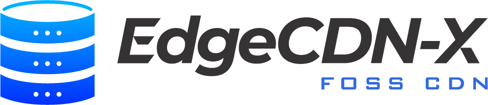

# Overview
## What is EdgeCDN-X

EdgeCDN-X is an open source CDN platform built on top of CNCF projects. It's core orchestration is built on top of kubernetes using CRDs and Custom controllers.

### Why EdgeCDN-X
EdgeCDN-X builds on top of the best practices of Kubernetes. Kubernetes is a platform for building platforms and solves many things from day one. Configuration distribution is in multi-cluster scenarios is achievable with ArgoCD, custom operators, Karmada or other CNCF backed open source projects.
EdgeCDN-X DNS is an intelligent GSLB routing layer, independent from the caching component. Use EdgeCDN-X DNS as a standalone component or use it as a base for a globally distributed CDN caching engine.

# Components
### EdgeCDN-X DNS
DNS is based on CoreDNS with a custom plugin which build on top of Kubernets CRDs for robust and dynamic configuration. Routing, healthchecks and prometheus metrics help decide which records to return to queries in real time. It's fully cached architecture supports large scale deployments with up to 10k zones and 150k records.

**Main Building Blocks**:

* **EdgeCDN-X Controller** - Installs CRDs, and does webhook based validations. In downstream role, it supports resource sync for resource syncronization to multiple locations to achieve High-Availability.
* **CoreDNS** - CoreDNS DNS with the edgecdnx-plugin is the routing brain of the solution. Support weighed load balancing, active-fallback scenarios, geoip. Apart from active healthchecks the CoreDNS routing component can include prometheus metrics when doing routing decisions
* **Healthchecker** - Manages active healthchecks towards the configured endpoints and updates the Resources when a health is changed. These changes are automatically reflected in the CoreDNS brain thanks to configured informers.

### EdgeCDN-X Caching
**ingress-nginx** based controller ensures that the configured Service resources are provisioned as ingress resources with caching capabilities. The Caching component is currently WIP, and not intended for heavy production use.

* **Caching** piece supports static HTTP(s) based origins and S3 upstreams
* **Secure-Urls** component ensures that unatuhenticated access is restricted and supports common streaming formats such as MPEG-DASH or HLS with Prefix based URL signatrues.

# License
Base components are Licensed with an AGPLv3 license, and are free to use for commercial purposes. The base components include:

* EdgeCDN-X Controller
* CoreDNS
* HealthChecker

The base license allow integrators to build a DNS solution with Caching capabilites built on top of the base components.

### Commercial add-ons
Additional components are available to build a fully e2e Control plane for Enterprise purposes. Enterprise featurse include API endpoint, User Interface, cert-manager and ACME support. For the full commercial platform perpertual licenses and subscription based licenses are available. 
The official public offering hosted at [portal.edgecdnx.com](https://portal.degecdnx.com) is running the full commercial stack with a free plan for both home and commercial use.

If you would like to deploy EdgeCDN-X DNS on your premises as a branded solution as a PaaS offering, feel free to [reach out](contact.md).