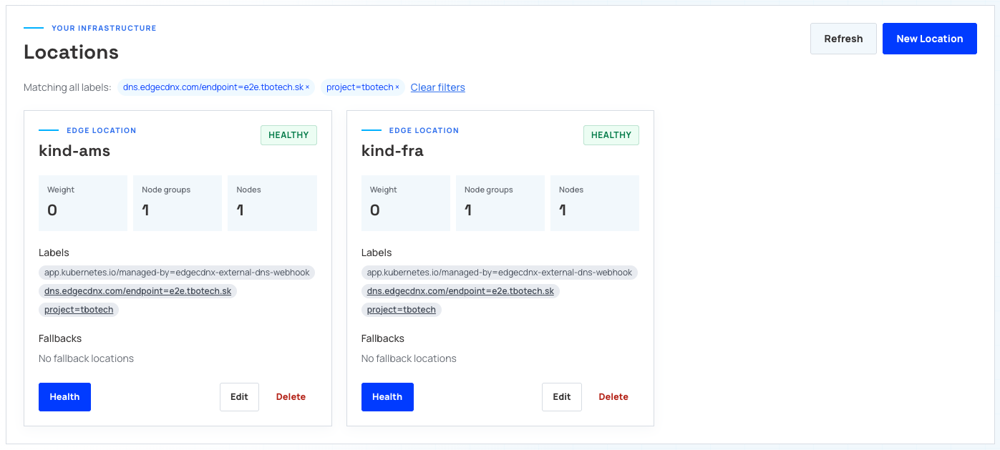
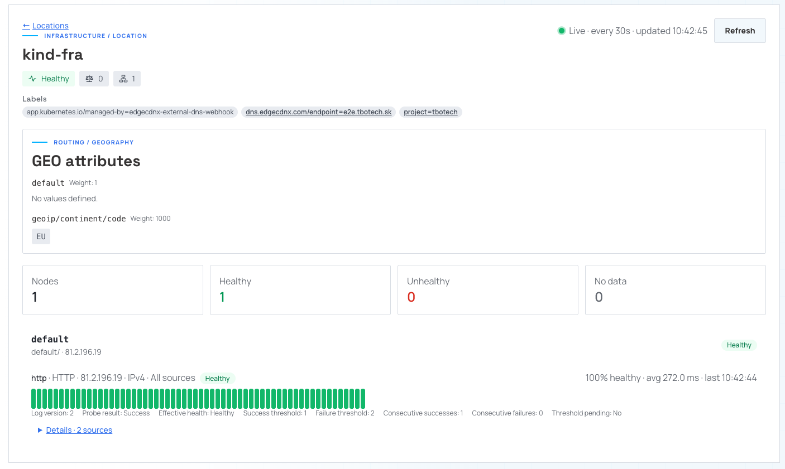

# Configuring ExternalDNS

ExternalDNS watches Kubernetes resources and publishes their DNS records through
the EdgeCDN-X ExternalDNS webhook. The webhook talks to the EdgeCDN-X Project API;
you do not need to install the EdgeCDN-X controller or its CRDs in the application
clusters.

This guide uses the two-cluster E2E layout: `kind-fra` and `kind-ams` publish
`e2e.tbotech.sk` through one Project. ExternalDNS and the webhook run together
in one Pod per cluster.

For local image building/loading and the automated test workflow, see the
[webhook E2E guide](https://github.com/EdgeCDN-X/edgecdnx-external-dns-webhook/blob/main/e2e/README.md).
The deployment below is based on its
[deployment template](https://github.com/EdgeCDN-X/edgecdnx-external-dns-webhook/blob/main/e2e/manifests/external-dns.yaml.tmpl)
and
[example configuration](https://github.com/EdgeCDN-X/edgecdnx-external-dns-webhook/blob/main/e2e/.env.example).

## Prerequisites
- Active account on [https://portal.edgecdnx.com](https://portal.edgecdnx.com)
- Kubernetes clusters accessible through `kubectl`; the examples uses `kind` clusters with contexts
  `kind-fra` and `kind-ams`.
- An EdgeCDN-X [Project](defining-projects.md) with a
  [Zone](defining-zones-and-records.md) covering your application hostname.
- A Project-scoped API key. Simple DNS management requires Zone `read` and
  `update` permissions. Routing annotations also require access to read and
  manage Locations and, when enabled, HealthCheckProfiles.
- Network access from the webhook to the EdgeCDN-X API.
- Access from both clusters to the released webhook image,
  `ghcr.io/edgecdn-x/edgecdnx-external-dns-webhook:latest`. For reproducible
  deployments, pin the image to a release tag or digest instead of `latest`.
- `envsubst` for rendering the deployment example.

The example pins ExternalDNS to `v0.24.0`, as in the E2E harness. Since
ExternalDNS `v0.22.0`, the default annotation prefix is
`external-dns.kubernetes.io/`. Older versions use
`external-dns.alpha.kubernetes.io/`; newer versions read that legacy prefix
only with `--enable-legacy-annotation-prefix`.

If the E2E demo is already deployed in both contexts, skip deployment and start
with [verification](#verify-the-deployment-and-records). The publishing examples
are illustrative: do not apply them over an existing demo unless you intend to
change its hostname, targets, and routing policy.

## Create the two kind clusters

For a local demo, install [kind](https://kind.sigs.k8s.io/docs/user/quick-start/),
Docker, and `kubectl`, and ensure Docker is running. Skip this step if your
`fra` and `ams` clusters already exist.

```bash
kind create cluster --name fra --wait 120s
kind create cluster --name ams --wait 120s

kubectl --context kind-fra get nodes
kubectl --context kind-ams get nodes
```

kind creates the kubeconfig contexts `kind-fra` and `kind-ams` automatically.
Each command creates a single-node cluster; no port mappings or Ingress
controller are needed for the DNS-only example below. Both clusters run locally:
the names describe the demo's routing identities, not physical regions.

The deployment pulls the released webhook image from GHCR, so no local image
build or `kind load docker-image` step is required.

## Deploy ExternalDNS and the webhook

### 1. Provide the API key

Create the namespace and a Secret in each cluster. Store the API key in a
protected local file outside your repository, containing only the key with no
trailing newline. Substitute its path below, or provision the same Secret through
your secret manager.

```bash
for context in kind-fra kind-ams; do
  kubectl --context "$context" create namespace external-dns \
    --dry-run=client -o yaml | kubectl --context "$context" apply -f -
  kubectl --context "$context" -n external-dns \
    create secret generic edgecdnx-api-key \
    --from-file=apiKey=/secure/path/edgecdnx-api-key \
    --dry-run=client -o yaml | kubectl --context "$context" apply -f -
done
```


### 2. Create the deployment manifest

Save the following as `external-dns.yaml.tmpl`. It installs a ServiceAccount,
read-only Kubernetes RBAC, and a Deployment with both containers.

```yaml
apiVersion: v1
kind: ServiceAccount
metadata:
  name: external-dns
  namespace: external-dns
---
apiVersion: rbac.authorization.k8s.io/v1
kind: ClusterRole
metadata:
  name: external-dns
rules:
  - apiGroups: [""]
    resources: ["services", "endpoints", "pods", "namespaces", "nodes"]
    verbs: ["get", "watch", "list"]
  - apiGroups: ["networking.k8s.io"]
    resources: ["ingresses"]
    verbs: ["get", "watch", "list"]
---
apiVersion: rbac.authorization.k8s.io/v1
kind: ClusterRoleBinding
metadata:
  name: external-dns
roleRef:
  apiGroup: rbac.authorization.k8s.io
  kind: ClusterRole
  name: external-dns
subjects:
  - kind: ServiceAccount
    name: external-dns
    namespace: external-dns
---
apiVersion: apps/v1
kind: Deployment
metadata:
  name: external-dns
  namespace: external-dns
spec:
  replicas: 1
  selector:
    matchLabels:
      app.kubernetes.io/name: external-dns
  template:
    metadata:
      labels:
        app.kubernetes.io/name: external-dns
    spec:
      serviceAccountName: external-dns
      containers:
        - name: external-dns
          image: registry.k8s.io/external-dns/external-dns:v0.24.0
          args:
            - --source=ingress
            - --provider=webhook
            - --webhook-provider-url=http://localhost:8888
            - --registry=txt
            - --txt-owner-id=${TXT_OWNER}
            - --txt-prefix=${TXT_PREFIX}
            - --policy=sync
            - --interval=30s
            - --log-level=info
        - name: edgecdnx-webhook
          image: ${WEBHOOK_IMAGE}
          imagePullPolicy: Always
          env:
            - name: EDGECDNX_API_URL
              value: "${EDGECDNX_API_URL}"
            - name: EDGECDNX_PROJECT_ID
              value: "${EDGECDNX_PROJECT_ID}"
            - name: EDGECDNX_API_KEY
              valueFrom:
                secretKeyRef:
                  name: edgecdnx-api-key
                  key: apiKey
            - name: WEBHOOK_LISTEN_ADDRESS
              value: "0.0.0.0:8888"
            - name: LOG_LEVEL
              value: info
          readinessProbe:
            httpGet:
              path: /healthz
              port: 8888
            initialDelaySeconds: 2
            periodSeconds: 5
```


### 3. Apply to each cluster

Set the non-secret connection details. Both clusters must be able to pull the
released image from GHCR.

```bash
export EDGECDNX_API_URL=https://api.edgecdnx.com
export EDGECDNX_PROJECT_ID=my-project
export WEBHOOK_IMAGE=ghcr.io/edgecdn-x/edgecdnx-external-dns-webhook:latest

for cluster in fra ams; do
  export TXT_OWNER="$cluster"
  export TXT_PREFIX="$cluster-"
  envsubst '${TXT_OWNER} ${TXT_PREFIX} ${WEBHOOK_IMAGE} ${EDGECDNX_API_URL} ${EDGECDNX_PROJECT_ID}' \
    < external-dns.yaml.tmpl |
    kubectl --context "kind-$cluster" apply -f -
  kubectl --context "kind-$cluster" -n external-dns \
    rollout status deployment/external-dns --timeout=120s
done
```

`imagePullPolicy: Always` checks the registry whenever the webhook container
starts, which avoids reusing a stale local `latest` tag. A new registry image
does not automatically restart running Pods; roll out updates explicitly.

The important settings are:

| Setting | Frankfurt | Amsterdam | Purpose |
| --- | --- | --- | --- |
| Kubernetes context | `kind-fra` | `kind-ams` | Selects the application cluster. |
| `--txt-owner-id` | `fra` | `ams` | Identifies each ExternalDNS instance's records. |
| `--txt-prefix` | `fra-` | `ams-` | Keeps ownership TXT records separate for a shared hostname. |
| Ingress `set-identifier` | `kind-fra` | `kind-ams` | Names the Location created in EdgeCDN-X. |

Both the TXT owner ID **and** TXT prefix must differ between clusters sharing a
hostname. Keep these identities stable across redeployments. Use a unique
set-identifier for each independently managed Location in the Project; do not
reuse a Location name for unrelated hostnames.

The webhook derives domain filters from the Project's Zones. `--source=ingress`
watches Ingress resources across namespaces with this RBAC. `--policy=sync`
allows deletions as well as creates and updates; use `--policy=upsert-only` if
you intentionally want to disable automatic deletion.

After rotating the API key Secret, restart the Deployment in each context so
the webhook receives the new environment value.

## Publish a hostname from both clusters

This example uses weighted routing: Frankfurt has weight `70`, Amsterdam `30`.
The examples use the demo hostname `e2e.tbotech.sk`. For your own deployment,
replace it with a hostname in your Project's Zone and replace the documentation
IP addresses with real, reachable application targets.

Save this as `ingress-fra.yaml`:

```yaml
apiVersion: networking.k8s.io/v1
kind: Ingress
metadata:
  name: e2e-app
  namespace: default
  annotations:
    external-dns.kubernetes.io/target: "203.0.113.10"
    external-dns.kubernetes.io/set-identifier: kind-fra
    external-dns.kubernetes.io/ttl: "60"
    external-dns.kubernetes.io/webhook-edgecdnx-routing: wrr
    external-dns.kubernetes.io/webhook-edgecdnx-weight: "70"
spec:
  rules:
    - host: e2e.tbotech.sk
      http:
        paths:
          - path: /
            pathType: Prefix
            backend:
              service:
                name: e2e-backend
                port:
                  number: 80
```

Create `ingress-ams.yaml` with the same hostname and backend, changing:

```yaml
external-dns.kubernetes.io/target: "198.51.100.20"
external-dns.kubernetes.io/set-identifier: kind-ams
external-dns.kubernetes.io/webhook-edgecdnx-weight: "30"
```

Apply each manifest to its own cluster:

```bash
kubectl --context kind-fra apply -f ingress-fra.yaml
kubectl --context kind-ams apply -f ingress-ams.yaml
```

The explicit `target` annotation supplies the DNS target without relying on an
Ingress controller's status address. The E2E example therefore needs no Ingress
controller or running backend Service to demonstrate DNS provisioning. It does
**not** deploy an application: for real traffic, the target must serve your
application, and a real Ingress deployment needs its controller and backend.

After reconciliation, expect two Locations named `kind-fra` and `kind-ams`, with
their target IPs in the default node group, and one shared `Weighted` DNSEndpoint
for the hostname and record type. The TXT registry also creates separate
ownership records for the two clusters.

## Choose a routing policy

All annotation suffixes below follow
`external-dns.kubernetes.io/webhook-`.

| Routing value | EdgeCDN-X policy | Additional annotations |
| --- | --- | --- |
| `simple` or omitted | `Simple` | No `set-identifier` or other `edgecdnx-*` settings. Publishes targets directly. |
| `wrr` | `Weighted` | `edgecdnx-weight`: required integer from `0` to `1000`. |
| `geo` | `Geolocation` | `edgecdnx-continents`, `edgecdnx-countries`, and/or `edgecdnx-geo-default: "true"`. At least one must select a region or enable the default. |
| `rr` | `RoundRobin` | No policy-specific annotations. |
| `failover` | `Failover` | `edgecdnx-failover-role`: `primary` (default) or `secondary`. Primary requires `edgecdnx-fallback` naming the fallback Location. |

Non-simple routing requires a valid DNS-1123 `set-identifier` and IP targets
producing `A` records. It cannot route a CNAME target through Locations.
All clusters publishing the same hostname and record type should use a
consistent routing policy and TTL.

For geolocation, replace the weighted routing annotations on Frankfurt with:

```yaml
external-dns.kubernetes.io/webhook-edgecdnx-routing: geo
external-dns.kubernetes.io/webhook-edgecdnx-continents: EU
external-dns.kubernetes.io/webhook-edgecdnx-countries: DE,AT,CH
```

On Amsterdam, use the same `geo` routing value and, for a catch-all Location:

```yaml
external-dns.kubernetes.io/webhook-edgecdnx-geo-default: "true"
```

Continent and country values are comma-separated uppercase two-letter codes.
They are routing criteria, not a declaration of the cluster's physical location.

For failover, configure Frankfurt with:

```yaml
external-dns.kubernetes.io/webhook-edgecdnx-routing: failover
external-dns.kubernetes.io/webhook-edgecdnx-failover-role: primary
external-dns.kubernetes.io/webhook-edgecdnx-fallback: kind-ams
```

Configure Amsterdam with:

```yaml
external-dns.kubernetes.io/webhook-edgecdnx-routing: failover
external-dns.kubernetes.io/webhook-edgecdnx-failover-role: secondary
```

The primary publishes the Failover endpoint; the secondary provisions its
Location without replacing the endpoint's primary target. See
[Location routing policies](defining-locations.md#routing-policies) for how
EdgeCDN-X selects nodes and follows fallback Locations.

When changing policies, remove annotations that belonged to the previous
policy. For example, `webhook-edgecdnx-weight` is rejected with `geo`. Update
both clusters' manifests rather than leaving a mixed-policy shared hostname.

## Add health checks

For any non-simple policy, add these annotations to each Ingress:

```yaml
external-dns.kubernetes.io/webhook-edgecdnx-health-endpoint: /healthz
external-dns.kubernetes.io/webhook-edgecdnx-health-protocol: http
external-dns.kubernetes.io/webhook-edgecdnx-health-port: "80"
```

The webhook creates a HealthCheckProfile named after the set-identifier and
attaches it to the Location's default node group. The HTTP Host header uses the
record's hostname. The protocol defaults to `http`; the port defaults to `80`
or `443` according to the protocol. The path must start with `/`, and an explicit
port must be between `1` and `65535`. Protocol and port annotations require a
health endpoint annotation.

The profile configures checks; it does not make an unreachable target healthy.
Use addresses and paths reachable by the EdgeCDN-X health check infrastructure.
The documentation IPs above are not real health-check targets. See
[Defining Health Checks](defining-healthchecks.md) for health-check operation.

## Verify the deployment and records

These commands are read-only and work with an already deployed E2E demo:

```bash
for context in kind-fra kind-ams; do
  echo "=== $context ==="
  kubectl --context "$context" -n external-dns get pods
  kubectl --context "$context" -n default get ingress e2e-app -o yaml
  kubectl --context "$context" -n external-dns \
    logs deployment/external-dns -c external-dns --tail=50
  kubectl --context "$context" -n external-dns \
    logs deployment/external-dns -c edgecdnx-webhook --tail=50
done
```

Allow at least one reconciliation interval (configured above as `30s`). Check
the Ingress hostname, target, set-identifier, and routing annotations in each
context before interpreting the API result.

In the EdgeCDN-X UI or Project API, inspect:

- **Locations:** one per set-identifier, with the correct target IPs and policy
  settings.
- **HealthCheckProfiles:** one per Location when health annotations are enabled.
- **Zone DNS endpoints:** one shared routed endpoint per hostname and record
  type, plus each cluster's ownership TXT records.

**Locations**:


Also check the Location **Health**



Once the Zone is served by EdgeCDN-X DNS, query an authoritative server directly:

```bash
dig @<authoritative-dns-server> e2e.tbotech.sk A
```

Use your own hostname if you changed it from `e2e.tbotech.sk`.
API provisioning and authoritative DNS resolution are separate checks;
public resolution also requires the appropriate Zone delegation. Cached
responses and node health affect observed answers, so a single DNS query is not
proof of a weighted traffic distribution.

## Troubleshooting and lifecycle

| Symptom | Check |
| --- | --- |
| Webhook Pod does not start | Secret `edgecdnx-api-key`, key `apiKey`, image availability, and API environment variables. |
| Webhook connection refused or readiness fails | Listener address, port `8888`, and probe configuration. |
| API authorization errors | Project ID, API key scope, and permissions for Zones, Locations, and HealthCheckProfiles as applicable. |
| Hostname is not published | The Project has a matching Zone; the Ingress has a host and target; annotation prefix matches the ExternalDNS version. |
| HTTP `400` from the webhook | Missing/invalid set-identifier, non-IP routed targets, invalid annotation values, or annotations from another policy. |
| Clusters overwrite or ignore each other's records | Distinct, stable TXT owner IDs and TXT prefixes, distinct set-identifiers, and consistent routing policy. |
| Existing Location cannot be adopted | The webhook refuses to modify Locations without its management and endpoint labels; choose a new set-identifier. |
| DNS returns no usable target | Inspect authoritative DNS, Location health and maintenance state, real target reachability, and Zone delegation. |

Set `LOG_LEVEL=debug` on the webhook and `--log-level=debug` on ExternalDNS
temporarily for more detail. Debug logs include DNS endpoint data; treat them
according to your operational logging policy.

Locations created by the webhook carry
`app.kubernetes.io/managed-by: edgecdnx-external-dns-webhook` and
`dns.edgecdnx.com/endpoint` labels. Do not manually repurpose these managed
resources; update the owning Ingress instead.

With `--policy=sync`, removing an Ingress lets ExternalDNS reconcile removal of
that cluster's managed contribution. Keep ExternalDNS running until the API
resources have reconciled, and verify the other cluster still serves the shared
hostname. Deleting the Deployment or kind cluster first does not send DNS
deletions and can leave remote resources behind.
