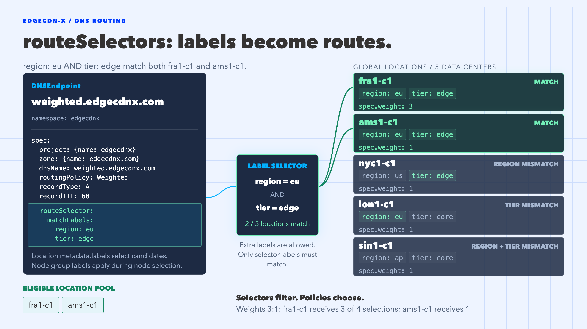

# Defining Locations

Locations represent targets where the requests are routed to. Within a location you can define multiple node groups and multiple nodes within a group. This is well defined for CDN use cases, where multiple caching engines could serve the same content within a same datacenter. Each node must define an IPv4 or IPv6 address, these addresses will be returned from the EdgeCDN-X DNS if they match the prerequisites.

## Creating Locations

Like zones and records, locations belong to a project and must be created in the project namespace. The examples below continue with the `edgecdnx` namespace, the `edgecdnx` project and the `edgecdnx.com` zone created in the previous guides.

We will define two locations, `fra1-c1` and `ams1-c1`. Both carry the same location labels, while their node groups carry an additional `cache` label:

```yaml
apiVersion: infrastructure.edgecdnx.com/v1alpha1
kind: Location
metadata:
  name: fra1-c1
  namespace: edgecdnx
  labels:
    region: eu
    tier: edge
spec:
  project:
    name: edgecdnx
  weight: 3
  fallbackLocations:
    - ams1-c1
  geoLookup:
    weight: 50
    attributes:
      geoip/continent/code:
        weight: 1000
        values:
          - value: EU
      default:
        weight: 1
  nodeGroups:
    - name: ssd
      flavor: ""
      labels:
        cache: ssd
      nodes:
        - name: n1
          ipv4: 192.168.80.10
        - name: n2
          ipv4: 192.168.80.11
    - name: hdd
      flavor: ""
      labels:
        cache: hdd
      nodes:
        - name: n3
          ipv4: 192.168.80.12
---
apiVersion: infrastructure.edgecdnx.com/v1alpha1
kind: Location
metadata:
  name: ams1-c1
  namespace: edgecdnx
  labels:
    region: eu
    tier: edge
spec:
  project:
    name: edgecdnx
  weight: 1
  fallbackLocations:
    - fra1-c1
  geoLookup:
    weight: 50
    attributes:
      geoip/continent/code:
        weight: 1000
        values:
          - value: EU
      geoip/country/code:
        weight: 100
        values:
          - value: NL
          - value: BE
  nodeGroups:
    - name: ssd
      flavor: ""
      labels:
        cache: ssd
      nodes:
        - name: n1
          ipv4: 192.168.80.20
```

```bash
➜  kubectl apply -f locations.yaml
location.infrastructure.edgecdnx.com/fra1-c1 created
location.infrastructure.edgecdnx.com/ams1-c1 created
```

The most relevant location fields are:

| Field | Description |
| --- | --- |
| `metadata.labels` | Location labels, used by route selectors to pick candidate locations. |
| `spec.project` | Reference to the owning project. Immutable. |
| `spec.weight` | Weight of the location for the `Weighted` routing policy. |
| `spec.fallbackLocations` | Ordered list of locations tried when this location has no healthy matching node. |
| `spec.parent` | Parent location for hierarchical setups. Cannot be combined with `fallbackLocations`. |
| `spec.maintenanceMode` | Removes the whole location from routing. |
| `spec.geoLookup` | Attributes and weights used by the `Geolocation` routing policy. |
| `spec.nodeGroups[].labels` | Node group labels, merged with the location labels when filtering nodes. |
| `spec.nodeGroups[].nodes[]` | Nodes with their `ipv4` and/or `ipv6` address and an optional `maintenanceMode` flag. |

## How Labels Work

Every node group has an effective label set: the location `metadata.labels` merged with the node group `labels`. If the same key is defined on both levels, the node group value wins. For the locations above the effective labels are:

| Location | Node group | Effective labels | Nodes |
| --- | --- | --- | --- |
| `fra1-c1` | `ssd` | `region=eu, tier=edge, cache=ssd` | `192.168.80.10`, `192.168.80.11` |
| `fra1-c1` | `hdd` | `region=eu, tier=edge, cache=hdd` | `192.168.80.12` |
| `ams1-c1` | `ssd` | `region=eu, tier=edge, cache=ssd` | `192.168.80.20` |

A `DNSEndpoint` uses a standard Kubernetes label selector in `spec.routeSelector`. Both `matchLabels` and `matchExpressions` are supported. Routing happens in two steps:

1. **Location selection** - the routing policy picks a target location from the candidate locations.
2. **Node selection** - within the target location only node groups whose effective labels match the route selector are considered. Nodes in maintenance mode, failing health checks or with active alerts are skipped. The node is then picked by hashing the queried name, so the same hostname consistently lands on the same node.

If no node is left, the plugin walks the `parent` location and then the `fallbackLocations` of the target, skipping any fallback location with no node group matching the route selector.

> **Candidate locations for Weighted and RoundRobin:** these policies select candidate locations by matching the route selector against the location `metadata.labels` only. A selector containing a node group label such as `cache: ssd` will match no location for these policies, so use location labels in their route selector. `Geolocation` evaluates the effective labels of each node group, so node group labels can be used there.

## Routing Policies

Routing policies other than `Simple` resolve to nodes of a location and therefore support only `A` and `AAAA` records. An `A` query returns the `ipv4` of the selected node, an `AAAA` query its `ipv6`.

| Policy | Location selection | Route selector |
| --- | --- | --- |
| `Simple` | None, `spec.targets` are returned as-is. | Not used |
| `Failover` | First entry of `spec.targets` is the primary location name. | Optional |
| `Weighted` | Smooth weighted round robin over matching locations using `spec.weight`. | Required |
| `RoundRobin` | Rotates over matching locations in alphabetical order. | Required |
| `Geolocation` | `PrefixList` match first, then the best `geoLookup` score. | Required |

### Failover

`Failover` routes to the location named in the first entry of `spec.targets`. The route selector narrows the node groups, so the following record only returns the `ssd` nodes of `fra1-c1`:

```yaml
apiVersion: infrastructure.edgecdnx.com/v1alpha1
kind: DNSEndpoint
metadata:
  name: failover.edgecdnx.com-a
  namespace: edgecdnx
spec:
  project:
    name: edgecdnx
  zone:
    name: edgecdnx.com
  dnsName: failover.edgecdnx.com
  recordTTL: 60
  recordType: A
  routingPolicy: Failover
  targets:
    - fra1-c1
  routeSelector:
    matchLabels:
      cache: ssd
```

```bash
➜  dig @127.0.0.1 -p 62747 failover.edgecdnx.com +short
192.168.80.10
```

Put `fra1-c1` into maintenance and the query falls back to `ams1-c1`, which is the first fallback location with a node group matching `cache: ssd`:

```bash
➜  kubectl patch location fra1-c1 -n edgecdnx --type merge -p '{"spec":{"maintenanceMode":true}}'
location.infrastructure.edgecdnx.com/fra1-c1 patched

➜  dig @127.0.0.1 -p 62747 failover.edgecdnx.com +short
192.168.80.20

➜  kubectl patch location fra1-c1 -n edgecdnx --type merge -p '{"spec":{"maintenanceMode":false}}'
location.infrastructure.edgecdnx.com/fra1-c1 patched
```

### Weighted

`Weighted` distributes queries across all locations matching the route selector proportionally to their `spec.weight`. It uses smooth weighted round robin, so the selections are interleaved rather than sent in bursts. With `fra1-c1` at weight `3` and `ams1-c1` at weight `1`, three out of every four queries are answered from `fra1-c1`:

```yaml
apiVersion: infrastructure.edgecdnx.com/v1alpha1
kind: DNSEndpoint
metadata:
  name: weighted.edgecdnx.com-a
  namespace: edgecdnx
spec:
  project:
    name: edgecdnx
  zone:
    name: edgecdnx.com
  dnsName: weighted.edgecdnx.com
  recordTTL: 60
  recordType: A
  routingPolicy: Weighted
  routeSelector:
    matchLabels:
      region: eu
      tier: edge
```

```bash
➜  for i in 1 2 3 4; do dig @127.0.0.1 -p 62747 weighted.edgecdnx.com +short; done
192.168.80.12
192.168.80.20
192.168.80.12
192.168.80.12
```

Since the selector only contains location labels, all node groups of `fra1-c1` are eligible and the hash for `weighted.edgecdnx.com` picks node `n3` of the `hdd` group.

Weighting rules:

- Locations with weight `0` are never selected while another matching location has a positive weight.
- If all matching locations have weight `0`, they are selected equally.
- The rotation state is kept per CoreDNS instance. With multiple replicas behind a load balancer, the ratio holds per replica and the observed order may differ.

Change the weights with `kubectl patch` and the new distribution takes effect immediately:

```bash
➜  kubectl patch location ams1-c1 -n edgecdnx --type merge -p '{"spec":{"weight":3}}'
location.infrastructure.edgecdnx.com/ams1-c1 patched
```

### RoundRobin

`RoundRobin` rotates over all locations matching the route selector, ignoring their weights. Locations are ordered alphabetically, so the rotation is stable across configuration reloads.

```yaml
apiVersion: infrastructure.edgecdnx.com/v1alpha1
kind: DNSEndpoint
metadata:
  name: roundrobin.edgecdnx.com-a
  namespace: edgecdnx
spec:
  project:
    name: edgecdnx
  zone:
    name: edgecdnx.com
  dnsName: roundrobin.edgecdnx.com
  recordTTL: 60
  recordType: A
  routingPolicy: RoundRobin
  routeSelector:
    matchLabels:
      tier: edge
```

### Geolocation

`Geolocation` first checks `PrefixList` resources for a match on the client source IP or EDNS client subnet. Without a match, locations are scored by their `spec.geoLookup` attributes against the GeoIP metadata of the request.

#### CoreDNS GeoIP Metadata

The attribute names in `spec.geoLookup.attributes` are CoreDNS metadata keys. They are only populated if both the `metadata` and the `geoip` plugins are enabled in the CoreDNS server block, as shown in the [standalone deployment](../standalone-dns-deployment.md#deploy-coredns-with-edgecdn-x-plugin):

```yaml
servers:
  - plugins:
      - name: metadata
      - name: geoip
        parameters: /etc/edgecdnx/geolookup/GeoLite2-City.mmdb
        configBlock: |-
          edns-subnet
      - name: edgecdnx
```

Without these plugins every attribute lookup is empty and only locations with a `default` attribute can match. With `edns-subnet` the lookup uses the EDNS client subnet sent by recursive resolvers instead of the resolver address. A City database provides keys such as:

| Metadata key | Example value |
| --- | --- |
| `geoip/continent/code` | `EU` |
| `geoip/country/code` | `NL` |
| `geoip/city/name` | `Amsterdam` |

See the [CoreDNS geoip plugin](https://coredns.io/plugins/geoip/) for the full list.

#### Scoring

For each candidate location the plugin computes a score:

- For every attribute whose request metadata value is listed in `values`, the attribute `weight` plus the value `weight` is added. Value weights are optional and may be negative.
- The special `default` attribute adds its `weight` to every request and makes the location match even if no other attribute does. It has no `values`.
- Locations matching no attribute and having no `default` are not candidates.
- The highest score wins. On a tie, a location is picked randomly, proportionally to `spec.geoLookup.weight`. If all tied weights are `0`, the pick is uniform.
- If no location is a candidate, the query is passed to the next CoreDNS plugin.

The locations defined at the top of this page score as follows:

| Client | `fra1-c1` | `ams1-c1` | Winner |
| --- | --- | --- | --- |
| Germany (`EU`, `DE`) | 1000 + 1 = 1001 | 1000 | `fra1-c1` |
| Netherlands (`EU`, `NL`) | 1000 + 1 = 1001 | 1000 + 100 = 1100 | `ams1-c1` |
| United States (`NA`, `US`) | 1 (default) | no match | `fra1-c1` |
| No GeoIP data (e.g. private IP) | 1 (default) | no match | `fra1-c1` |

The `default` weight on `fra1-c1` makes it the catch-all for clients outside Europe. Because `default` is also added to European requests, keep it small compared to the attribute weights, otherwise it decides between European locations too.

Now define the record. Here the selector can include node group labels:

```yaml
apiVersion: infrastructure.edgecdnx.com/v1alpha1
kind: DNSEndpoint
metadata:
  name: geo.edgecdnx.com-a
  namespace: edgecdnx
spec:
  project:
    name: edgecdnx
  zone:
    name: edgecdnx.com
  dnsName: geo.edgecdnx.com
  recordTTL: 60
  recordType: A
  routingPolicy: Geolocation
  routeSelector:
    matchLabels:
      region: eu
      cache: ssd
```

Querying from the local machine sends a private source address, so there is no GeoIP data and the `default` attribute routes to an `ssd` node of `fra1-c1`:

```bash
➜  dig @127.0.0.1 -p 62747 geo.edgecdnx.com +short
192.168.80.10
```

To simulate a client in the Netherlands, send an EDNS client subnet located there (`145.100.0.0/24` resolves to `EU` / `NL` in GeoLite2-City). The answer switches to `ams1-c1`:

```bash
➜  dig @127.0.0.1 -p 62747 geo.edgecdnx.com +short +subnet=145.100.0.0/24
192.168.80.20
```

A German subnet (`81.169.145.0/24`, `EU` / `DE`) stays on `fra1-c1`:

```bash
➜  dig @127.0.0.1 -p 62747 geo.edgecdnx.com +short +subnet=81.169.145.0/24
192.168.80.10
```

See [Prefix-Based Routing](../coredns.md#prefix-based-routing) to override GeoIP decisions for specific networks with `PrefixList` resources.

## Using matchExpressions

Selectors are not limited to exact matches. The following selector matches `edge` locations outside the `us` region, and only node groups that carry a `cache` label:

```yaml
routeSelector:
  matchLabels:
    tier: edge
  matchExpressions:
    - key: region
      operator: NotIn
      values: ["us"]
    - key: cache
      operator: Exists
```

Remember that for `Weighted` and `RoundRobin` the `cache` expression would be evaluated against location labels only and match nothing.

## Route Selector Example

The diagram below illustrates the `Weighted` example: only `fra1-c1` and `ams1-c1` match both `region: eu` and `tier: edge`. The additional locations illustrate label mismatches and are not part of the manifests above. The matching locations are then selected according to their weights of `3` and `1`.



